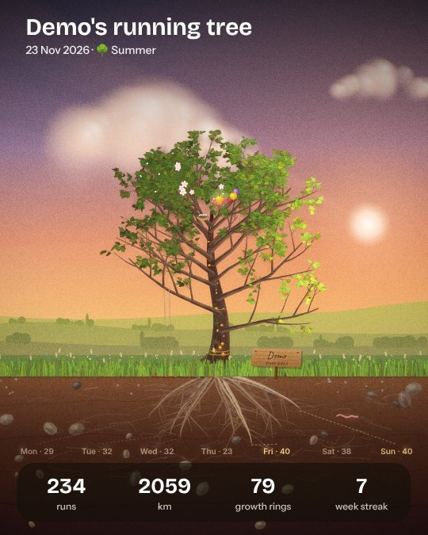
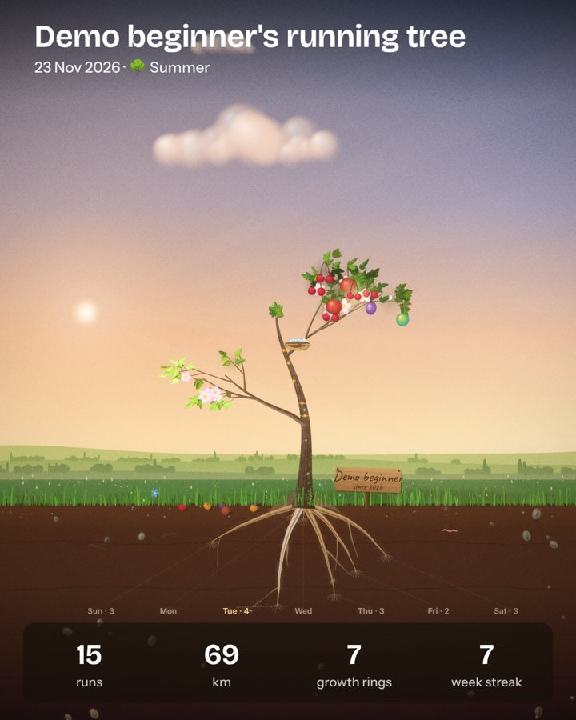
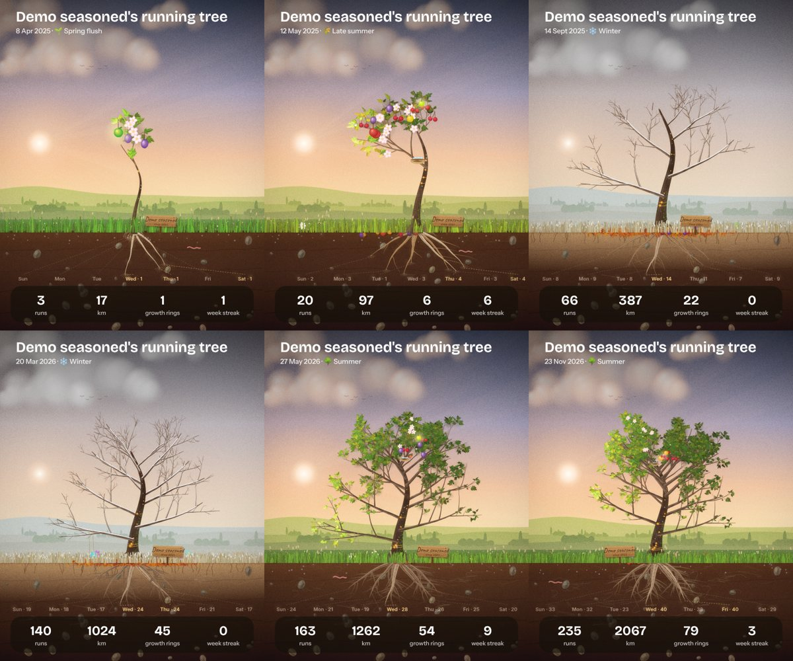

# 🌳 FitTree — a living tree grown from your running habit

Every run grows a twig. Every week you show up adds a growth ring to the trunk.
Stop running and the leaves turn amber, fall, and the tree goes into winter —
come back and it buds again. The tree is rebuilt from Google Health (or Strava) twice a day and a
weekly card is sent on Sunday morning with what grew and what to do next.

| A mature habit, dawn runner | Same tree, evening runner | A new habit (5 weeks) |
|:---:|:---:|:---:|
|  |  |  |

**Time-lapse** — the same runner from the first week to today, through a
three-week break (autumn → bare winter with fallen leaves) and back to summer:



*(images above are from synthetic demo data — `python -m fittree demo`)*

## How to read the tree

Every part is computed from the runs; nothing is decoration-only.

| Part | Grown from |
|---|---|
| 🪵 **Trunk girth & height** | **Persistence.** Each week with a run adds a growth ring of "wood"; consecutive weeks add more (up to +60 % for a 10-week streak). The trunk never shrinks. The side panel shows the real ring slice: one ring per week, thick = strong week, dark = missed. |
| 🌿 **Roots** | **Weekly rhythm.** One root per weekday, as thick as the share of runs that land on that day. Your *anchor day* glows. |
| 🌳 **Limbs** | **Months.** A strong month (runs vs. your weekly target, km vs. your usual month) grows a long, thick limb. A month without runs leaves a dormant bud. Limbs older than 18 months are shed into the trunk as scars. |
| 🌱 **Branches** | **Weeks** along each month's limb, sized by that week's strength. |
| 🪴 **Twigs** | **Single runs**, placed along the week branch by weekday. Length ∝ √distance, kinked by elevation/km (trail runs are gnarly), lifted upward by pace relative to *your* median. Long runs fork. |
| 🍃 **Leaves** | ≈1.6 leafy sprigs per km of that run, lit by the sun of your usual running hour (sunlit side warm, inner crown shaded, backlit at dawn and dusk). |
| 🎨 **Leaf colour** | **Your last weeks.** Last 10 days of training time vs. your usual 6 weeks: building → *spring flush*, steady → *summer*, fading → *late summer/autumn*, 3 weeks off → *winter* (bare, snow). A spike above ~135 % → *heatwave* (red-tipped leaves). Colour eases in slowly, like a real tree. |
| 🍒🍎🍊🫐🌟 **Fruit** | **Latest runs** (last 3 weeks): cherries = easy, apple = long, orange = fast/tempo, plums = hilly/trail, golden apple = race. "Long" and "fast" are judged against your own last 10 weeks, so a beginner's 6 km is already an apple. The newest fruit glows. |
| 🌸 **Blossoms** | Personal bests (longest run yet, fastest 5K/10K/half yet), Strava PRs, and new milestones. |
| ✨ **Amber** | Milestones in the bark: first 5K/10K/half/marathon (full amber rings), 100/500/1,000 km, 50/100 runs (amber beads). |
| 🪺 **Nest** | Current weekly streak: a nest from 2 weeks, one egg per week (max 6), a robin moves in at 8 weeks. |
| 💧 **Soil** | **Watering.** Every run waters the tree: dark, moist soil (with a worm and droplets) for a few days, then it pales and cracks, the grass turns to straw and the leaves start to hang. |
| 🪵 **Carved initial** | After 12 weeks with a run, your initial and the year you started are carved into the bark. |
| 🪢 **Swing** | After 26 weeks with a run, a swing hangs from your strongest low limb. |
| 🕳️ **Knots** | Weeks without a run, at the height of the trunk where they happened. |
| 🌼 **Meadow** | Cross-training (rides, swims, walks, yoga…) from the last 90 days blooms as wildflowers, coloured by sport. |
| 🌅 **Sky** | The time of day you usually run (dawn, morning, midday, evening, night). Butterflies = kudos. |

The tree is alive on the page: wind rolls through the crown (limbs, branches and
twigs each sway on their own), leaves flutter, dust drifts in the light, and the
freshest leaves glisten. It's painted like an old photograph: warm grade, faded
blacks, film grain and a soft vignette, with a hand-lettered sign bearing the
runner's name.

The page is interactive: hover any twig/fruit/root/ring for the run behind it,
drag the slider or press **Watch it grow** for the time-lapse. Every element is
seeded by what it represents (athlete + run id), so the tree is perfectly
stable and scrubbing to any past date regrows exactly the tree you had then.

## Little worlds (prototypes)

`site/<key>/worlds.html` grows the same tree into three self-contained worlds,
inspired by hand-made procedural worlds like
[Brushwild](https://kevintngo.github.io/procedural-rpg/):

| | |
|---|---|
| **World in a jar** | The tree inside a snow globe on a turned-wood base with an engraved brass plaque. Drag to shake it: petals, seeds, leaves, snow or fireflies swirl depending on your last weeks. After 4 days without a run the glass mists over; you can wipe it, but only running keeps it clear. |
| **Little planet** | The tree on a tiny planet that grows with your kilometres. Drag to spin; day and night sweep across it. Weekday roots reach a core that glows with your streak, a little runner does laps (faster after a bigger month), and milestones orbit as moons. |
| **Field journal** | The tree drawn in graphite and coloured pencil on a notebook page, the lines re-laid six times a second like a hand-drawn film, with hand-written notes pointing at what each part means. |

## Quick start

```bash
python -m fittree demo demo --kind seasoned     # synthetic runner, no account needed
python -m fittree build demo --png              # -> site/demo/index.html + tree.png
python -m pytest -q
```

Python ≥ 3.10 with only the standard library; the PNG card needs Node +
Playwright (`npm i playwright && npx playwright install chromium`).

## Getting the runs in

Strava's API needs a paid developer subscription since June 2026, so the
default source is Google. Set `"source"` per athlete in `athletes.json`
(`google` or `strava`).

**1. History, once: Google Takeout.** <https://takeout.google.com> → *Deselect
all* → tick **Fit** (and **Fitbit / Google Health** if you have it) → export
to Drive or download. Then:

```bash
python -m fittree inspect takeout-*.zip    # what's inside
python -m fittree import asaf takeout-*.zip
python -m fittree build asaf --png
```

The importer reads Fit's per-workout `.tcx` files (time, distance, elevation,
heart rate) and session `.json` summaries, merges duplicates, and converts UTC
to local time (`timezone` in `athletes.json`). Loose `.tcx` files from any
app work too. Export before Google switches the Fit APIs off (end of 2026):
Fit history doesn't move to Health Connect by itself.

**2. Ongoing, with permission: Google Health API.** Google's cloud successor
to the Fit REST API: each person approves read access once on Google's
consent screen, and the weekly job reads new workouts with a refresh token.

1. In <https://console.cloud.google.com>: new project → enable **Google
   Health API** → *Google Auth Platform*: Audience *External*, then
   **Publish app** (status *In production*; in *Testing*, refresh tokens die
   after 7 days). Unverified apps are fine for up to 100 people; they see a
   "Google hasn't verified this app" screen and tap *Continue*.
2. Data access → add scope `…/auth/googlehealth.activity_and_fitness.readonly`.
3. Clients → *Create client* → **Desktop app** → note the ID and secret.
4. Each runner must have opened the **Google Health** app and signed in once.

```bash
export GOOGLE_CLIENT_ID=... GOOGLE_CLIENT_SECRET=...
python -m fittree auth asaf          # opens Google's consent page, saves .secrets/asaf.env
python -m fittree exchange amir      # prints a consent link to send to Amir
python -m fittree exchange amir 'http://127.0.0.1:8766/?code=...'   # the address he sends back
python -m fittree sync && python -m fittree build --png
```

Only workouts that appear in the Google Health app are visible to this API
(Fitbit, Pixel Watch and apps that sync into it), so check that your runs show
up there first.

**3. Strava (paid API).** Set `"source": "strava"`, create an app at
<https://www.strava.com/settings/api>, then `python -m fittree auth asaf`.
Strava's free account archive (*Settings → My Account → Download or Delete
Your Account*) also imports: `python -m fittree import asaf activities.csv`.

## Sending it weekly (GitHub Actions)

`.github/workflows/grow.yml` runs twice a day: sync → build → publish to
GitHub Pages, and on Sunday morning (Israel time) sends the card.

1. *Settings → Pages → Source: GitHub Actions.*
2. *Settings → Secrets and variables → Actions* — secrets:
   `GOOGLE_CLIENT_ID`, `GOOGLE_CLIENT_SECRET`, `GOOGLE_REFRESH_TOKEN_ASAF`,
   `GOOGLE_REFRESH_TOKEN_AMIR` (or the `STRAVA_*` equivalents), and for delivery either
   - Telegram: `TELEGRAM_BOT_TOKEN` (from @BotFather) + `TELEGRAM_CHAT_ID_AMIR`
     (Amir sends the bot `/start`, then read the id from
     `https://api.telegram.org/bot<TOKEN>/getUpdates`), or
   - Email: `SMTP_HOST`, `SMTP_PORT`, `SMTP_USER`, `SMTP_PASSWORD`, `EMAIL_TO_AMIR`
     (a Gmail app password works).
   Variable `SITE_URL` = your Pages URL, so messages link to the live tree.
3. *Actions → Grow the trees → Run workflow* (tick **send** to test).

Per-athlete settings live in `athletes.json`: `week_start` (Israel → `sunday`),
`target_runs` per week (what counts as a full-strength branch — Amir starts at
2), `send` channels, and `show_run_names: false` to keep run titles off the page.

**Privacy:** the published page contains dates, distances, pace, elevation and
(optionally) run titles — never GPS tracks or maps. GitHub Pages sites are
public; drop `show_run_names` or skip Pages and only send the card if that
matters.

## Layout

```
fittree/   model.py   normalized Activity
           google.py  Google Takeout (Fit) import, TCX parser, Google Health API client
           strava.py  Strava OAuth + API sync, bulk-export import
           habits.py  runs -> genome (weeks, wood, streaks, season, roots, milestones)
           story.py   weekly message: what grew, why, what's next
           site.py    self-contained HTML page per athlete, PNG card
           notify.py  Telegram / email
web/       tree.js    growth engine + canvas renderer (botany only — meaning lives in habits.py)
           viewer.*   the interactive page
```

The first version of this repo (2021, Google Fit + space colonization) is in
the git history at `d5517e8`.
