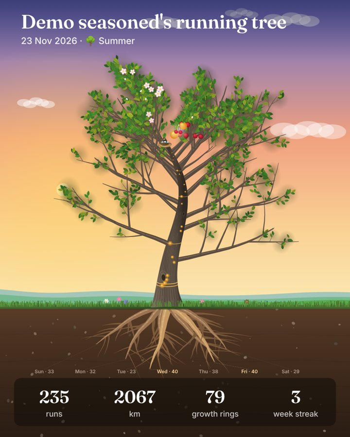

# 🌳 FitTree — a living tree grown from your running habit

Every run grows a twig. Every week you show up adds a growth ring to the trunk.
Stop running and the leaves turn amber, fall, and the tree goes into winter —
come back and it buds again. The tree is rebuilt from Strava twice a day and a
weekly card is sent on Sunday morning with what grew and what to do next.

| A mature habit (20 months) | A new habit (5 weeks) |
|:---:|:---:|
|  |  |

**Time-lapse** — the same runner from the first week to today, through a
three-week break (autumn → bare winter with fallen leaves) and back to summer:


*(images above are from synthetic demo data — `python -m fittree demo`)*

## How to read the tree

Every part is computed from the runs; nothing is decoration-only.

| Part | Grown from |
|---|---|
| 🪵 **Trunk girth & height** | **Persistence.** Each week with a run adds a growth ring of "wood"; consecutive weeks add more (up to +60 % for a 10-week streak). The trunk never shrinks. The side panel shows the real ring slice: one ring per week, thick = strong week, dark = missed. |
| 🌿 **Roots** | **Weekly rhythm.** One root per weekday, as thick as the share of runs that land on that day. Your *anchor day* glows. |
| 🌳 **Limbs** | **Months.** A strong month (runs vs. your weekly target, km vs. your usual month) grows a long, thick limb. A month without runs leaves a dormant bud. Limbs older than 18 months are shed into the trunk as scars. |
| 🌱 **Branches** | **Weeks** along each month's limb, sized by that week's strength. |
| 🪴 **Twigs** | **Single runs**, placed along the week branch by weekday. Length ∝ √distance, kinked by elevation/km (trail runs are gnarly), lifted upward by pace relative to *your* median. Long runs fork. |
| 🍃 **Leaves** | ≈1.6 leaves per km of that run. |
| 🎨 **Leaf colour** | **Your last weeks.** Last 10 days of training time vs. your usual 6 weeks: building → *spring flush*, steady → *summer*, fading → *late summer/autumn*, 3 weeks off → *winter* (bare, snow). A spike above ~135 % → *heatwave* (red-tipped leaves). Colour eases in slowly, like a real tree. |
| 🍒🍎🍊🫐🌟 **Fruit** | **Latest runs** (last 3 weeks): cherries = easy, apple = long, orange = fast/tempo, plums = hilly/trail, golden apple = race. "Long" and "fast" are judged against your own last 10 weeks, so a beginner's 6 km is already an apple. The newest fruit glows. |
| 🌸 **Blossoms** | Runs with Strava PRs or new milestones. |
| ✨ **Amber** | Milestones in the bark: first 5K/10K/half/marathon (full amber rings), 100/500/1,000 km, 50/100 runs (amber beads). |
| 🪺 **Nest** | Current weekly streak: a nest from 2 weeks, one egg per week (max 6), a robin moves in at 8 weeks. |
| 🕳️ **Knots** | Weeks without a run, at the height of the trunk where they happened. |
| 🌼 **Meadow** | Cross-training (rides, swims, walks, yoga…) from the last 90 days blooms as wildflowers, coloured by sport. |
| 🌅 **Sky** | The time of day you usually run (dawn, morning, midday, evening, night). Butterflies = kudos. |

The page is interactive: hover any twig/fruit/root/ring for the run behind it,
drag the slider or press **Watch it grow** for the time-lapse. Every element is
seeded by what it represents (athlete + run id), so the tree is perfectly
stable and scrubbing to any past date regrows exactly the tree you had then.

## Quick start

```bash
python -m fittree demo demo --kind seasoned     # synthetic runner, no account needed
python -m fittree build demo --png              # -> site/demo/index.html + tree.png
python -m pytest -q
```

Python ≥ 3.10 with only the standard library; the PNG card needs Node +
Playwright (`npm i playwright && npx playwright install chromium`).

## Getting Strava data

**1. Strava API app (needed for the automatic weekly tree).**
Create an app at <https://www.strava.com/settings/api> (any name; *Authorization
Callback Domain* = `localhost`). Then, for each athlete:

```bash
export STRAVA_CLIENT_ID=... STRAVA_CLIENT_SECRET=...
python -m fittree auth asaf        # opens Strava, catches the redirect, saves .secrets/asaf.env
```

For someone who isn't at your computer (Amir):

```bash
python -m fittree exchange amir    # prints a consent link — send it to Amir
```

Amir taps **Authorize**; his browser lands on a `localhost` page that won't
load — he sends you the address (it contains `code=…`, single-use, useless
without your client secret). Then `python -m fittree exchange amir <code>`.
Keep the default *View data about your activities* box ticked.

**2. Strava bulk export** (no API app): Strava → Settings → My Account →
*Download or Delete Your Account* → *Request your archive*, then
`python -m fittree import asaf path/to/activities.csv`.

**3. Any JSON list of Strava activities** (e.g. exported via the Strava
connector): `python -m fittree import asaf activities.json`.

## Sending it weekly (GitHub Actions)

`.github/workflows/grow.yml` runs twice a day: sync → build → publish to
GitHub Pages, and on Sunday morning (Israel time) sends the card.

1. *Settings → Pages → Source: GitHub Actions.*
2. *Settings → Secrets and variables → Actions* — secrets:
   `STRAVA_CLIENT_ID`, `STRAVA_CLIENT_SECRET`, `STRAVA_REFRESH_TOKEN_ASAF`,
   `STRAVA_REFRESH_TOKEN_AMIR`, and for delivery either
   - Telegram: `TELEGRAM_BOT_TOKEN` (from @BotFather) + `TELEGRAM_CHAT_ID_AMIR`
     (Amir sends the bot `/start`, then read the id from
     `https://api.telegram.org/bot<TOKEN>/getUpdates`), or
   - Email: `SMTP_HOST`, `SMTP_PORT`, `SMTP_USER`, `SMTP_PASSWORD`, `EMAIL_TO_AMIR`
     (a Gmail app password works).
   Variable `SITE_URL` = your Pages URL, so messages link to the live tree.
3. *Actions → Grow the trees → Run workflow* (tick **send** to test).

Per-athlete settings live in `athletes.json`: `week_start` (Israel → `sunday`),
`target_runs` per week (what counts as a full-strength branch — Amir starts at
2), `send` channels, and `show_run_names: false` to keep run titles off the page.

**Privacy:** the published page contains dates, distances, pace, elevation and
(optionally) run titles — never GPS tracks or maps. GitHub Pages sites are
public; drop `show_run_names` or skip Pages and only send the card if that
matters.

## Layout

```
fittree/   model.py   normalized Activity
           strava.py  OAuth + API sync, bulk-export import
           habits.py  runs -> genome (weeks, wood, streaks, season, roots, milestones)
           story.py   weekly message: what grew, why, what's next
           site.py    self-contained HTML page per athlete, PNG card
           notify.py  Telegram / email
web/       tree.js    growth engine + canvas renderer (botany only — meaning lives in habits.py)
           viewer.*   the interactive page
```

The first version of this repo (2021, Google Fit + space colonization) is in
the git history at `d5517e8`.
